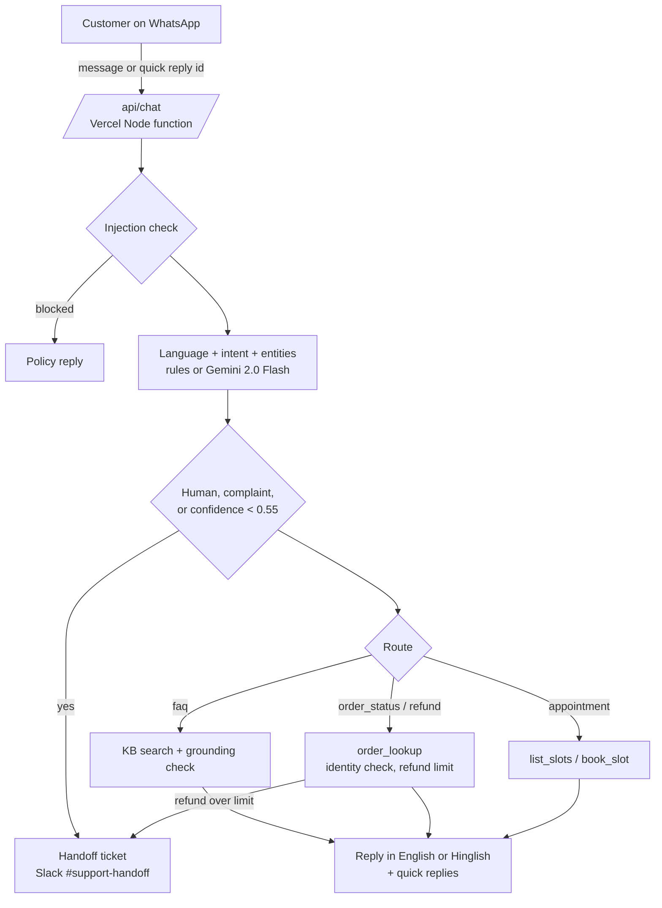

<div align="center">

<h1>WhatsApp Support Agent</h1>

<p>A WhatsApp support agent for Indian small businesses that answers only from your knowledge base, looks up orders, books slots, and hands the chat to a person when it should.</p>

<p>
  <a href="https://whatsapp-support-agent.vercel.app"></a>
  <a href="n8n/whatsapp-support-agent.n8n.json"></a>
  <a href="LICENSE"></a>
  
  
</p>

<p>
  <a href="https://whatsapp-support-agent.vercel.app"><b>Live demo</b></a> ·
  <a href="#n8n-workflow"><b>n8n workflow</b></a> ·
  <a href="#how-it-works"><b>Architecture</b></a> ·
  <a href="#run-locally"><b>Run locally</b></a>
</p>

</div>

## Overview

A D2C brand, a clinic, or a coaching centre gets the same WhatsApp questions all day: where is my order, do you have COD, can I book for tomorrow. A bot that guesses is worse than no bot, so this agent answers only from the business knowledge base, uses real lookups for orders and slots, and hands complaints, large refunds, and anything it is unsure about to a person with a ticket in Slack. The playground shows a phone chat beside a trace of every decision, and the included n8n workflow runs the same flow on the WhatsApp Cloud API.

## Highlights

- **Grounded answers only.** FAQ replies come from KB entries with a match score of at least 0.5; anything else is refused with an offer to reach a person.
- **Six intents with confidence.** `faq`, `order_status`, `appointment`, `refund`, `complaint`, `human`, with a 0.55 confidence floor below which the chat is handed off.
- **English and Hinglish.** Detects Hinglish (and Devanagari) and replies in Hinglish from a parallel KB.
- **Real handoff rules.** Complaints, requests for a person, low confidence, and refunds above the business limit (₹1,500, ₹500, ₹2,000 per preset) open a handoff ticket.
- **Visible trace.** Intent probabilities, rule signals, entities, tool calls with arguments, guardrail decisions, and the Slack ticket for every reply.
- **Works without keys.** Demo mode is deterministic; add a Gemini key and the model classifies and words FAQ answers while the guardrails still decide.

## How it works



1. The browser sends the business id, the message (or a quick reply id such as `slot:d1-1130`), and the conversation state to `POST /api/chat`.
2. `api/_agent.js` detects the language, extracts order ids, phone numbers, days and times, and scores the six intents with a softmax over rule signals (or asks Gemini in live mode).
3. Guardrails run in a fixed order: prompt injection, escalation policy, medical advice, confidence floor, identity check, then KB grounding or refund limit per route.
4. Tools run against the mock back office in `api/_businesses.js`: `kb_search`, `order_lookup`, `initiate_refund`, `list_slots`, `book_slot`, `create_handoff`.
5. The UI renders the reply as a chat bubble with quick reply chips, and the full trace beside it.

| Preset | Type | Auto-refund limit | Try |
|--------|------|-------------------|-----|
| Glow & Co. | D2C skincare store, Bengaluru | ₹1,500 | Order tracking, COD, refund for GLW-20377, skin consultation |
| SmileCare Dental | Dental clinic, Hyderabad | ₹500 | Check-up booking, root canal fees, painkiller question |
| Apex Coaching Institute | JEE and NEET coaching, Hyderabad | ₹2,000 | Fees, scholarship test, admission status, demo class |

## Business impact

Estimated, not measured. Assume 1,500 WhatsApp chats a month, of which about 60% are FAQ, order status, or booking questions (a typical range is 50 to 70%).

- **About 45 staff hours a month** saved at roughly 3 minutes per automated chat.
- **Answers outside business hours** for order status, policies, and bookings.
- **Fewer wrong answers** than a free-form bot, because uncovered questions are refused and money decisions go to a person.

## Tech stack

| Layer | Tools |
|-------|-------|
| Frontend | Static `index.html`, `assets/style.css`, `assets/app.js` (vanilla ES modules, no build step) |
| API | Vercel Node serverless functions (ESM, zero dependencies, Node 18+ `fetch`) |
| Model | Google Gemini REST API, `gemini-2.0-flash` in JSON mode (optional) |
| Production flow | n8n, WhatsApp Cloud API (Graph API v21.0), Slack incoming webhook |
| Tests | `node:test`, GitHub Actions on Node 20 |
| Fonts | Inter, JetBrains Mono |

## Project structure

```
.
├── index.html
├── assets/    style.css · app.js
├── api/       chat.js · businesses.js · status.js
│              _agent.js (pipeline, guardrails, tools) · _businesses.js (presets) · _gemini.js
├── n8n/       whatsapp-support-agent.n8n.json
├── scripts/   dev-server.mjs
├── test/      agent.test.js · api.test.js · n8n.test.js
└── package.json · vercel.json · .env.example · LICENSE · SECURITY.md · CHANGELOG.md
```

## Run locally

```bash
git clone https://github.com/Saitarun29/whatsapp-support-agent
cd whatsapp-support-agent
npm run dev                          # http://localhost:3000, demo mode, no install needed
GEMINI_API_KEY=your_key npm run dev  # live mode
npm test                             # 21 tests
```

`npx vercel dev` works too.

## Configuration

| Variable | Required | Purpose |
|----------|----------|---------|
| `GEMINI_API_KEY` | No | Live mode: Gemini 2.0 Flash classifies intents and words FAQ answers. Without it, or on error or timeout, the deterministic path answers. Never sent to the browser. |
| `MODEL_TIMEOUT_MS` | No | Per-call model timeout. Default 8000. |
| `RATE_LIMIT_PER_MIN` | No | Messages per minute per IP per instance. Default 40. |

`/api/chat` accepts POST only, bodies up to 16 KB, and messages up to 600 characters. A model answer is used only if every number in it appears in the cited KB entries.

## n8n workflow

**[`n8n/whatsapp-support-agent.n8n.json`](n8n/whatsapp-support-agent.n8n.json)** is the production version: Meta webhook verification (GET), message intake (POST) with retry dedupe, Gemini classification with a rules fallback, guardrails in code, a Switch to KB answer, order lookup over HTTP, slot listing and booking over HTTP, or a Slack handoff, then a reply through the Graph API. It holds no credentials and reads everything from `$env`.

1. In n8n, choose *Import from File* and pick the JSON.
2. Set `WHATSAPP_VERIFY_TOKEN`, `WHATSAPP_TOKEN`, `WHATSAPP_PHONE_NUMBER_ID`, `GEMINI_API_KEY`, `ORDERS_API_URL`, `ORDERS_API_TOKEN`, `BOOKING_API_URL`, `SLACK_WEBHOOK_URL`, and optionally `REFUND_AUTO_LIMIT`.
3. Replace the sample KB in the *Route + Guardrails* node with your own entries.
4. Activate it and set `https://<your-n8n>/webhook/whatsapp` as the callback URL in the Meta app dashboard.

## Deploy

[](https://vercel.com/new/clone?repository-url=https://github.com/Saitarun29/whatsapp-support-agent&env=GEMINI_API_KEY)

Zero config. Leave `GEMINI_API_KEY` empty to ship in demo mode.

---

<div align="center">

Built by **Sai Tarun Ronanki** · AI Systems & Agentic Workflows Builder · Hyderabad

[saitarun.com](https://saitarun.com) · [LinkedIn](https://linkedin.com/in/ronanki-sai-tarun) · [X](https://x.com/SaiTarunRonanki)

**[Discuss your workflow →](https://wa.me/918008941430?text=Hello%20Sai%20Tarun%20Ronanki,%20I%20want%20to%20discuss%20about%20my%20workflow)**

MIT © 2026 Sai Tarun Ronanki

</div>
